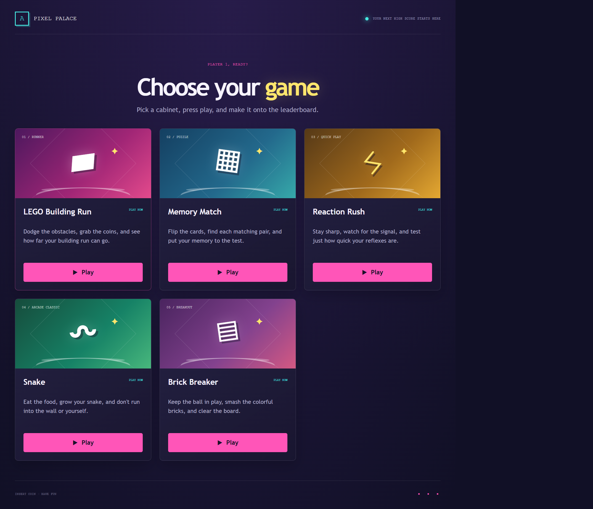

# Pixel Palace Arcade

Pixel Palace is a retro-inspired browser arcade with six games. It is built with HTML, CSS, and JavaScript and works on desktop and mobile browsers.

## Home page



## Games

| Game | Description |
| --- | --- |
| [LEGO Building Run](tap%20game/index.html) | Dodge obstacles, collect coins, choose a difficulty, and submit scores to the leaderboard. |
| [Memory Match](memory%20game/index.html) | Flip cards and find all eight matching pairs. |
| [Reaction Rush](Reaktion%20game/index.html) | Wait for the screen to turn green, then tap as quickly as you can. |
| [Snake](snake/index.html) | Eat the food, grow longer, and avoid the walls and your tail. |
| [Brick Breaker](brick-breaker/index.html) | Bounce the ball with the paddle and clear the bricks. |
| [Asteroid Hop](platformer/index.html) | Leap across asteroids, dodge aliens, and reach each level checkpoint. |

## Run locally

Serve the repository over HTTP so the game's JavaScript modules load correctly.

1. Open a terminal in the repository root.
2. Start a local server:

   ```sh
   python -m http.server 8000
   ```

3. Visit [http://localhost:8000/Arcade/](http://localhost:8000/Arcade/).

You can also use a local web server extension in your code editor.

## Controls

- **LEGO Building Run:** Choose Easy, Normal, or Hard to start. Follow the in-game controls.
- **Memory Match:** Select two cards at a time; use **Shuffle & restart** to begin again.
- **Reaction Rush:** Tap or click the game area when it turns green.
- **Snake:** Use the arrow keys or swipe on the board to steer.
- **Brick Breaker:** Use the arrow keys, or drag the paddle; on phones, touch and drag.
- **Asteroid Hop:** Tap the pilot name field to use the phone keyboard, use the arrow keys or on-screen controls to move and jump, and press P to pause.

## Project structure

```text
Arcade/
|-- index.html
|-- style.css
|-- tap game/
|-- memory game/
|-- Reaktion game/
|-- snake/
|-- brick-breaker/
`-- platformer/
```

Each game folder contains its own page, styles, and game logic. The LEGO Building Run folder also includes the Supabase leaderboard setup SQL.

## GitHub Pages

The repository root `index.html` forwards to this arcade page. To publish from GitHub Pages, configure the repository to deploy the `main` branch from the repository root in **Settings > Pages**.
